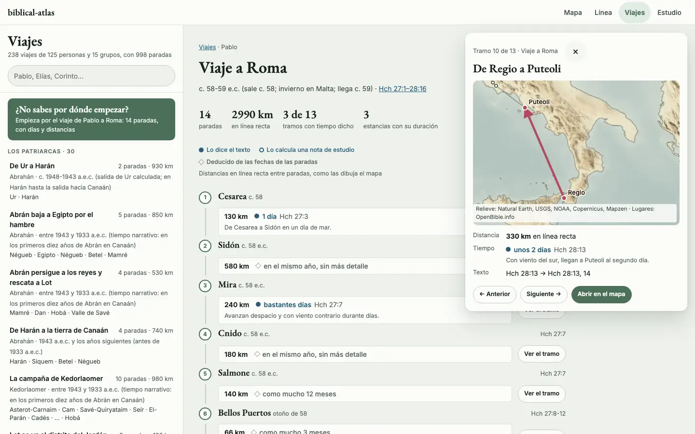
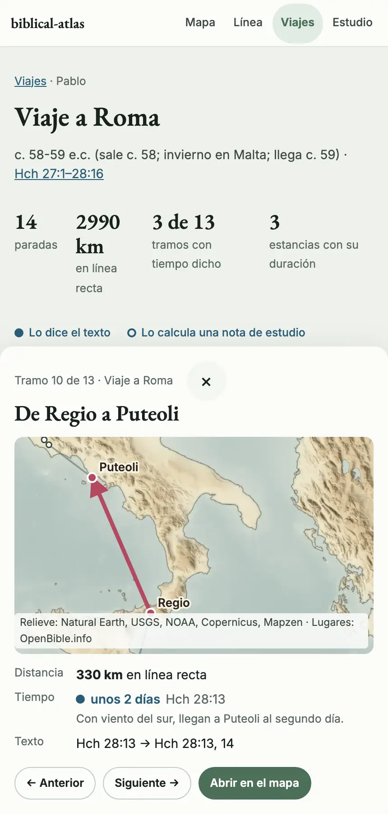
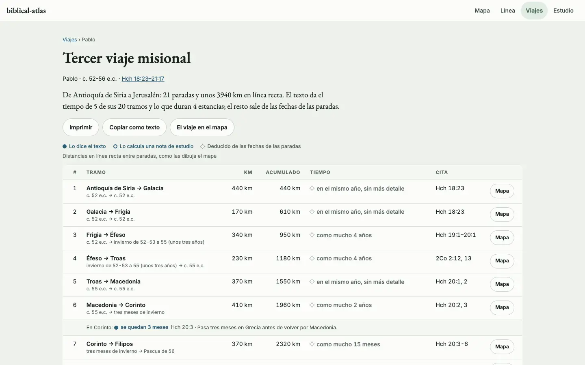
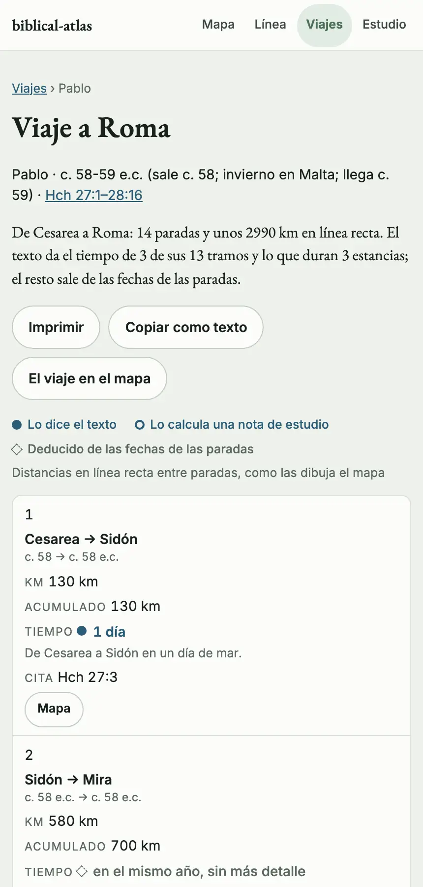
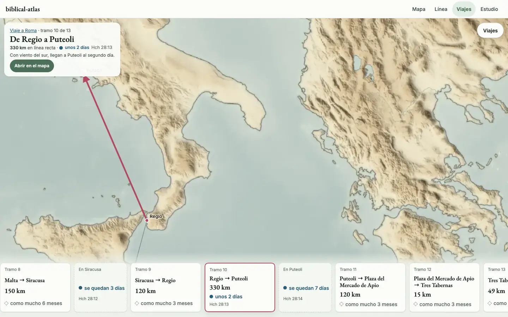
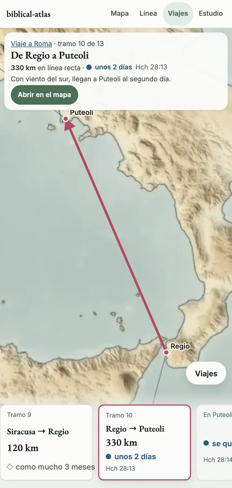
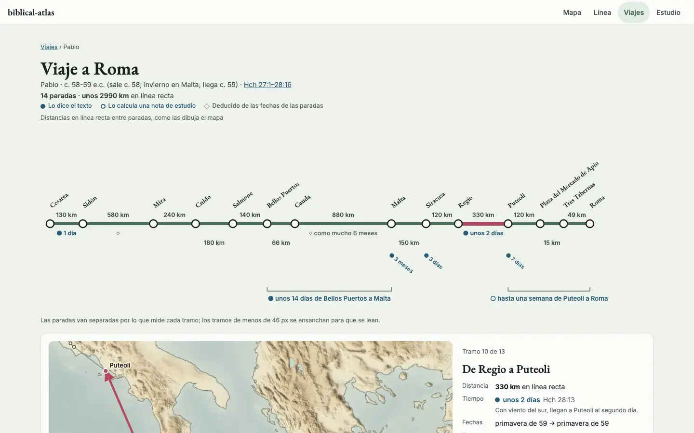
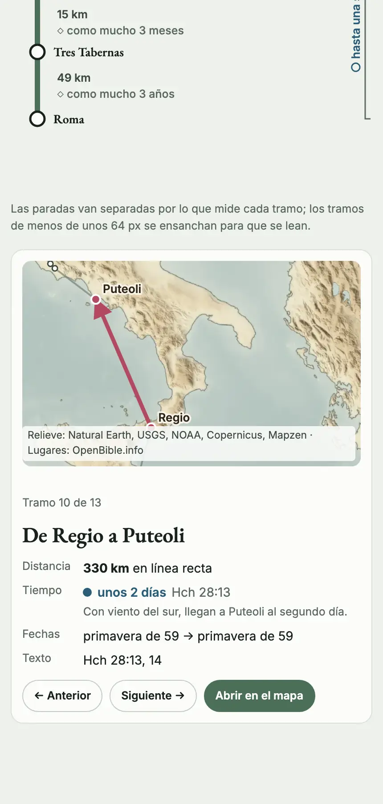

# Viajes: cuatro diseños para una sección propia

Quien abre el atlas por primera vez no sabe por dónde empezar. En una demostración lo dijeron así: «tanta información, no sé ni por dónde empezar» y «es un mejunje enorme». Y pidieron una cosa concreta: una sección de viajes que cuente cómo se movía Pablo, cuánto duró cada tramo y qué distancia hay entre parada y parada, algo que sirva para preparar un discurso. Estamos de acuerdo, y aquí hay cuatro diseños para elegir.

Este documento no cambia [`site/`](../../site/) ni [`data/`](../../data/). Los cuatro prototipos usan los viajes de `site/data.json`, el tema copiado para la portada y nuestros propios fondos de relieve. Todas las cifras de pantalla están medidas en un navegador real, a 1440x900 con ratón y a 430x900 con pantalla táctil.

## 1. Lo que el sitio ya tiene

- **Los viajes, en los datos.** 238 viajes de 125 personas y 15 grupos, con 998 paradas. El modelo está decidido en [viajes-modelo.md](viajes-modelo.md): viajes de grupo, paradas deducidas de puntos, acompañantes por tramos y la ventana en que el mapa dibuja cada viaje. Los destinos en paralelo, en [destinos-paralelos.md](destinos-paralelos.md).
- **El mapa** dibuja el viaje que está en curso en la fecha del cursor, con su ruta parada a parada.
- **La línea de tiempo** da a cada viajero elegido su carril, con un tramo por viaje y sus paradas debajo, y tiene el carril fijo «Viajes de Pablo» ([linea-viajes.md](linea-viajes.md)).
- **Los recorridos guiados** de [`recorridos.js`](../../site/js/recorridos.js): cuatro (las cartas de Pablo, de Babilonia a Jerusalén, la última semana de Jesús y Pedro), de 8 a 18 paradas. Cada parada mueve la fecha, el mapa y la ficha, y traen preguntas de repaso, hoja para imprimir y modo presentación.
- **La portada** abre por tres puertas: el mapa en una fecha, las relaciones entre personas y un capítulo con su mapa («¿Por dónde pasó Pablo en Hechos 16?»). Debajo ofrece los recorridos.

Lo que falta, y lo que pide la sección:

- **Ninguna lista de viajes.** Para ver uno hay que saber antes su fecha o su viajero. Los recorridos son cuatro y cuentan una historia, no un viaje.
- **Ninguna distancia.** El sitio no dice en ningún sitio cuántos kilómetros hay de una parada a otra.
- **Ningún tiempo por tramo.** Las paradas tienen fecha, pero nadie resta una de otra ni dice lo que el texto cuenta («al día siguiente», «tres meses»).
- **El tramo no existe como cosa que se elige.** Hoy se elige un viaje (`#sel=viaje:…`) o una parada (`#sel=parada:<viaje>/<n>`), nunca el camino entre dos.

## 2. Lo que todos los diseños respetan

1. **Se empieza sin pensar.** La sección tiene un «¿Por dónde empiezo?» a la vista que lleva a un viaje, el de Pablo a Roma, y una guía de tres pasos como mucho.
2. **No abruma.** Poco texto y pocos controles en la primera pantalla; lo demás, a un paso.
3. **Todos los viajes, con sus paradas.** Agrupados por época, con quién viaja, la fecha, las paradas y los kilómetros, y un filtro por nombre, persona o lugar.
4. **Cada tramo dice su distancia y su tiempo, y de dónde sale.** Una marca distingue lo que dice el texto (punto lleno), lo que calcula una nota de estudio (aro) y lo que deducimos de las fechas de las paradas (rombo vacío).
5. **Del tramo al mapa.** Cada tramo se abre con el mapa encuadrado en él, y «Abrir en el mapa» lleva al atlas en esa parada.
6. **Sirve para preparar un discurso.** Las citas a la vista, los totales y lo que el texto dice con sus palabras resumidas.
7. **Funciona para todos.** En el teléfono, con el teclado y en modo reunión; nada que se toca mide menos de 32 px, y los botones, 44.
8. **Poco peso y nada copiado.** Ninguna imagen nueva, los fondos y el tema que ya teníamos, y los textos con nuestras palabras.

## 3. Las distancias y los tiempos

Los cuatro diseños leen lo mismo, que escribe [`distancias.py`](mockups/viajes/distancias.py) en `datos.js`.

**La distancia de un tramo** es la del círculo máximo entre los dos puntos que el mapa dibuja para sus paradas: el punto del lugar o, si es incierto, su candidato preferido, con la misma regla que `BE.puntoLugar` en [`trayectorias.js`](../../site/js/trayectorias.js). Es la línea recta que se ve en el mapa, no la calzada ni la costa, y los diseños lo dicen junto a la cifra. La de un viaje es la suma de sus tramos. Se redondea a un decimal por debajo de 10 km, a la unidad hasta 100 y a la decena por encima. De los 760 tramos, 5 no se miden porque una de sus paradas es un área que el texto no sitúa.

La comprobamos con tres tramos cuya distancia da la nota de estudio de Hechos 28. La regla pide que la recta quede a menos de un 10 % de la cifra de la nota:

| Tramo del viaje a Roma | Calculado | La nota de estudio | Diferencia |
|---|---|---|---|
| Regio a Puteoli (Hch 28:13) | 329,2 km | unos 320 km | +2,9 % |
| Plaza del Mercado de Apio a Tres Tabernas (Hch 28:15) | 14,8 km | unos 15 km | −1,4 % |
| Tres Tabernas a Roma (Hch 28:15) | 48,9 km | unos 50 km | −2,2 % |

La nota de Hch 27:3 da unos 110 km de Cesarea a Sidón por mar, y la recta da 126,2 (+14,7 %). No la usamos como control: los puntos de las dos ciudades están tierra adentro de sus puertos, y el script la enseña como aviso.

El control puede fallar, y lo hemos visto: con `--control`, que mueve Roma 0,6° al este, el tramo de Tres Tabernas a Roma da 40,7 km (−18,6 %) y el script sale con error.

**El tiempo de un tramo** sale de dos sitios:

- **Lo que dice el texto**, en [`tiempos.json`](mockups/viajes/tiempos.json): 10 tramos, 2 trechos de varios tramos y 8 estancias, cada uno con su cita, su fuente, su razón, `checked_on` y `status`. Por ejemplo, 5 días de Filipos a Troas (Hch 20:6), unos 14 días de tormenta de Bellos Puertos a Malta (Hch 27:27, 33) o 3 meses en Malta (Hch 28:11). La nota de Hch 28:14, que calcula hasta una semana de Puteoli a Roma, lleva la marca de nota de estudio.
- **Lo que deducimos de las fechas**: el tope entre el principio de la fecha de una parada y el final de la siguiente. Si las dos tienen día, es la diferencia exacta.

Lo que sale con los datos de hoy:

| Tiempo de un tramo | Tramos |
|---|---|
| Lo dice el texto | 10 |
| Deducido, con día exacto en las dos paradas | 19 |
| Deducido, «como mucho» días, semanas, meses o años | 129 |
| Deducido, «en el mismo año, sin más detalle» | 602 |

Es la limitación de fondo, y ningún diseño la esconde: el texto da el tiempo de muy pocos tramos. Los diseños enseñan siempre la marca, para que nadie lea un «como mucho 6 meses» deducido como si lo dijera la Biblia.

## 4. Los cuatro diseños

Cada diseño se abre con un clic en su nombre. Hay que servir la carpeta, como se explica [al final](#9-cómo-abrir-los-prototipos). En cada uno, la imagen de la izquierda es el ordenador y la de la derecha, el teléfono.

### 1. [Cuaderno de viajes](mockups/viajes/cuaderno/index.html)

<table>
<tr>
<td width="72%"></td>
<td width="28%"></td>
</tr>
</table>

**Cómo se usa.** A la izquierda, la lista de todos los viajes por época, con quién, la fecha, las paradas y los kilómetros. Arriba de la lista, una caja verde: «¿No sabes por dónde empezar?». En el centro, el viaje elegido parada a parada, con sus totales y, entre cada dos paradas, el tramo con su distancia y su tiempo. «Ver el tramo» abre un panel con el mapa encuadrado, «Anterior», «Siguiente» y «Abrir en el mapa». En el teléfono, la lista y el viaje son dos pantallas, y el tramo es una hoja inferior.

**La primera visita.** La caja verde abre el viaje a Roma con tres avisos, cada uno junto a lo que explica: los totales, la marca del tiempo y el botón del tramo. El tercero abre el tramo de Regio a Puteoli ([en el ordenador](img/viajes/cuaderno-guia-1440.webp), [en el teléfono](img/viajes/cuaderno-guia-430.webp)).

**A qué renuncia.** Es la más larga de leer: con un tramo abierto hay 515 palabras a la vista en el ordenador. No imprime ni copia.

**Qué cuesta.** Medio. Una vista nueva, del tamaño de la lectura, y una selección nueva para el tramo.

En cifras: 13 controles y 291 palabras en la primera pantalla del ordenador ([la lista](img/viajes/cuaderno-lista-1440.webp)), y 13 y 245 en el teléfono ([la lista](img/viajes/cuaderno-lista-430.webp)). Cuatro pulsaciones de la caja verde al tramo, todas de la guía.

### 2. [La hoja para el discurso](mockups/viajes/hoja/index.html)

<table>
<tr>
<td width="72%"></td>
<td width="28%"></td>
</tr>
</table>

**Cómo se usa.** Es una hoja de trabajo. La entrada hace dos preguntas: de quién vas a hablar (Pablo, Jesús, Abrahán, Moisés, Elías, David) y cuál de sus viajes. Para Pablo propone primero el viaje a Roma, fijado a mano; para los demás, el que tiene más tramos con tiempo dicho. Debajo va la tabla de todos los viajes, que se filtra y se ordena por kilómetros. Un viaje es una tabla de tramos con el acumulado, una frase de resumen («De Cesarea a Roma: 14 paradas y unos 2990 km…»), «Imprimir» y «Copiar como texto». «Mapa» abre el tramo dentro de la fila.

**La primera visita.** [Pablo ya elegido](img/viajes/hoja-lista-1440.webp), con «Para empezar» sobre el viaje a Roma. Tres pulsaciones hasta el primer tramo con su mapa.

**A qué renuncia.** El mapa es lo último y queda pequeño, dentro de una fila. En el teléfono la tabla se vuelve una pila de tarjetas larga ([la lista](img/viajes/hoja-lista-430.webp)). Es la que menos se parece al resto del sitio.

**Qué cuesta.** Bajo. Tablas y una hoja de impresión, que los recorridos ya tienen.

En cifras: 20 controles y 291 palabras en la primera pantalla del ordenador, 15 y 182 en el teléfono. El tramo abierto dentro de su fila: [en el ordenador](img/viajes/hoja-tramo-1440.webp); el tercer viaje: [en el teléfono](img/viajes/hoja-viaje-430.webp).

### 3. [El mapa y su tira](mockups/viajes/mapa/index.html)

<table>
<tr>
<td width="72%"></td>
<td width="28%"></td>
</tr>
</table>

**Cómo se usa.** El mapa ocupa la pantalla. Abajo, una tira de tarjetas: una por tramo, con la distancia y el tiempo, y entre ellas las estancias que da el texto. Tocar una tarjeta encuadra el mapa en ese tramo. La lista de viajes es un cajón con la forma de cada ruta en pequeño ([la lista](img/viajes/mapa-lista-1440.webp)); con un tramo abierto se pliega en el botón «Viajes».

**La primera visita.** Una caja ([en el ordenador](img/viajes/mapa-guia-1440.webp), [en el teléfono](img/viajes/mapa-guia-430.webp)) con tres pasos y «Empezar con el viaje a Roma», y dos avisos junto a la tira y al mapa. Dos pulsaciones hasta un tramo.

**A qué renuncia.** No hay totales ni acumulados, y no se imprime. La tira enseña cuatro o cinco tramos y el resto queda a un desplazamiento de lado. En el teléfono la lista está tras un botón. La caja del tramo puede tapar una parada: en la captura del ordenador tapa el nombre de Puteoli, y en el sitio el encuadre tendría que descontarla.

**Qué cuesta.** Alto. En el sitio, el mapa es MapLibre y no una imagen: hace falta un modo del mapa que dibuje un viaje fuera de su fecha y encuadre un tramo, y una tira nueva.

En cifras: 21 controles y 333 palabras en la primera pantalla del ordenador, 8 y 109 en el teléfono ([la lista](img/viajes/mapa-lista-430.webp)). Con un tramo abierto, 13 y 170 en el ordenador.

### 4. [El viaje en una línea](mockups/viajes/esquema/index.html)

<table>
<tr>
<td width="72%"></td>
<td width="28%"></td>
</tr>
</table>

**Cómo se usa.** Cada viaje es una línea cuyo largo es lo que mide, todos a la misma escala ([la lista](img/viajes/esquema-lista-1440.webp)): se ve de un vistazo qué viaje es largo y cuál corto. Dentro de un viaje, las paradas van separadas por los kilómetros de cada tramo; encima va la distancia, debajo el tiempo con su marca y, en una llave, el tiempo que el texto da para varios tramos juntos. Tocar un tramo abre su mapa y sus datos debajo. En el teléfono la línea va de arriba abajo.

**La primera visita.** «Recorrerlo» abre el primer tramo del viaje a Roma con una guía de tres frases ([en el ordenador](img/viajes/esquema-guia-1440.webp), [en el teléfono](img/viajes/esquema-guia-430.webp)). Una pulsación hasta un tramo con su mapa.

**A qué renuncia.** En un tramo corto no cabe el tiempo y queda solo su marca; el resto se lee en el panel. Un viaje con muchas paradas cercanas se aprieta. No imprime.

**Qué cuesta.** Medio. Un dibujo nuevo de la línea y la misma selección de tramo que el cuaderno.

En cifras: 17 controles y 195 palabras en la primera pantalla del ordenador, 14 y 159 en el teléfono ([la lista](img/viajes/esquema-lista-430.webp)). Es la que menos enseña de entrada.

## 5. Modo reunión

Los cuatro siguen el modo reunión del sitio. La vista del tramo en cada uno: [cuaderno](img/viajes/cuaderno-tramo-1440-reunion.webp), [hoja](img/viajes/hoja-tramo-1440-reunion.webp), [mapa](img/viajes/mapa-tramo-1440-reunion.webp) y [línea](img/viajes/esquema-tramo-1440-reunion.webp). En el teléfono: [cuaderno](img/viajes/cuaderno-tramo-430-reunion.webp), [hoja](img/viajes/hoja-tramo-430-reunion.webp), [mapa](img/viajes/mapa-tramo-430-reunion.webp) y [línea](img/viajes/esquema-tramo-430-reunion.webp).

## 6. Los diseños, regla por regla

Probamos los cuatro prototipos en el navegador con tres miradas:

- **Primera visita.** Alguien que llega nuevo, en el ordenador.
- **Teléfono.** Una mano, pantalla de 430 px.
- **Discurso.** Alguien que prepara una charla sobre un viaje.

| Nota sobre 10 | Cuaderno | Línea | Hoja | Mapa |
|---|---|---|---|---|
| Primera visita | 8 | 8,5 | 6,5 | 7,5 |
| Teléfono | 8 | 7 | 6 | 7,5 |
| Discurso | 8 | 7,5 | 9 | 5,5 |

Una sola palabra quiere decir que las tres miradas coinciden. Tres palabras, en este orden: primera visita, teléfono, discurso.

| Regla | Cuaderno | Línea | Hoja | Mapa |
|---|---|---|---|---|
| 1. Se empieza sin pensar | sí | sí | sí · en parte · sí | sí |
| 2. No abruma | en parte | sí | en parte | sí · sí · en parte |
| 3. Todos los viajes, con sus paradas | sí | sí | sí | en parte |
| 4. Distancia y tiempo, con su marca | sí | en parte · sí · en parte | sí | sí |
| 5. Del tramo al mapa | sí | sí | en parte | sí |
| 6. Sirve para un discurso | en parte | en parte | sí | no |
| 7. Funciona para todos | sí | sí · en parte · sí | sí · en parte · sí | sí |
| 8. Poco peso y nada copiado | sí | sí | sí | en parte |

Dónde no coinciden y por qué:

- **Hoja, regla 1.** En el teléfono, las dos preguntas y las seis sugerencias ocupan más de una pantalla antes de llegar a la tabla.
- **Línea, regla 4.** En el teléfono cada tramo tiene sitio para su tiempo. En el ordenador los tramos cortos solo llevan la marca, y quien prepara un discurso tiene que abrirlos uno a uno.
- **Línea, regla 7.** En el teléfono la línea del viaje a Roma mide unos 1600 px de alto antes de llegar al panel del tramo.
- **Mapa, regla 2.** La pantalla está limpia, pero para un discurso faltan los totales y los acumulados, que hay que sumar a mano.
- **Mapa, regla 8.** Los prototipos pintan sobre una imagen; en el sitio es un modo nuevo de MapLibre, y es el diseño que más código pide.

Lo que comprobamos en los cuatro, con [`capturas.mjs`](mockups/viajes/capturas.mjs):

- Ningún error de consola, ningún fichero sin cargar y nada que se salga a lo ancho, en 32 capturas.
- Nada que se toca mide menos de 32 px, salvo los enlaces dentro de una frase.
- La primera visita llega a un tramo con el mapa encuadrado en él, en el ordenador y en el teléfono: una pulsación en la línea, dos en el mapa, tres en la hoja y cuatro en el cuaderno.
- Un enlace con un viaje que no existe (`#viaje=no-existe`) no deja la página en blanco: el cuaderno, la hoja y la línea vuelven a la lista, y el mapa abre el viaje a Roma.

## 7. Qué recomendamos

Recomendamos **el Cuaderno** como base. Es el más parejo con las tres miradas, un 8 en cada una, es el más claro en el teléfono y es el que da, tal cual, lo que se pidió: la lista de viajes con sus paradas y cada tramo con su distancia, su tiempo y su mapa. La Línea queda muy cerca y es mejor para la primera visita; quien la prefiera como base no se equivoca. Le añadiríamos tres cosas de los otros:

| Qué | De qué diseño |
|---|---|
| La lista de viajes como líneas a escala, para ver de un vistazo cuáles son largos | Línea |
| «Imprimir», «Copiar como texto», el acumulado y la frase de resumen del viaje | Hoja |
| En el sitio, «Abrir en el mapa» encuadra el tramo con el mapa de verdad, sin un mapa propio en la sección | Mapa |

Y quitaríamos texto de la primera pantalla: la caja verde y la lista bastan, sin la bienvenida del centro.

**Peso.** En el sitio, la sección sería un módulo como los de `site/js/`. Los ficheros del Cuaderno, comprimidos con gzip: unos 5 KB lo común, 3 KB el diseño y 4 KB de estilos, y 2 KB los tiempos dichos. Las distancias se calculan en el navegador con las coordenadas que el sitio ya descarga, así que no añaden datos. Ninguna imagen nueva: el mapa del tramo es el del sitio. En el repositorio, esta propuesta añade 106 KB de prototipos, scripts y tiempos, 277 KB de `datos.js` (40 KB con gzip), que se rehace con un script, y 1,8 MB en 32 capturas WebP.

## 8. Lo que decide el dueño

| Pregunta | Nuestra recomendación |
|---|---|
| ¿Qué diseño es la base? | El Cuaderno, con la tabla anterior. |
| ¿Dónde entra «Viajes»: en la barra, como «Mapa» y «Línea», o como una cuarta puerta de la portada? | En los dos: en la barra para quien vuelve, y en la portada junto a los recorridos para quien llega. |
| ¿Los tiempos dichos van a los datos? Hoy están en un fichero del prototipo. | Sí: un campo opcional en la parada, con su cita y su fuente, revisado con el protocolo de siempre. |
| ¿El tramo se vuelve una selección del sitio (`#sel=tramo:<viaje>/<n>`)? | Sí. Sin ella, «Abrir en el mapa» abre la parada de llegada y no el tramo. |
| ¿Enseñamos el tope deducido aunque sea largo («como mucho 3 años»)? | Sí, con su marca. Callarlo dejaría el tramo sin dato, y la marca dice que no lo da el texto. |
| ¿Distancia en línea recta, o por calzadas y costas? | En línea recta, diciéndolo. Por calzadas haría falta una red de caminos con fuente, que no tenemos. |
| ¿Qué viaje abre la primera visita? | El viaje a Roma: en un solo relato (Hch 27:1–28:16) reúne 3 tramos con tiempo dicho, 2 trechos (uno dicho y otro que calcula una nota de estudio, el único de ese tipo), 3 estancias y las tres distancias de control. El que más tramos con tiempo dicho tiene es el tercer viaje, con 5 tramos y 4 estancias, pero sin trechos ni controles. |

## 9. Cómo abrir los prototipos

Desde la raíz del repositorio. La primera orden hace falta solo una vez, para compilar los datos:

```bash
python3 scripts/build.py
python3 docs/ideas/mockups/viajes/distancias.py   # rehace datos.js y comprueba las distancias
python3 -m http.server 8941 --bind 127.0.0.1
```

| Diseño | Dirección |
|---|---|
| Los cuatro | <http://127.0.0.1:8941/docs/ideas/mockups/viajes/> |
| 1. Cuaderno de viajes | <http://127.0.0.1:8941/docs/ideas/mockups/viajes/cuaderno/> |
| 2. La hoja para el discurso | <http://127.0.0.1:8941/docs/ideas/mockups/viajes/hoja/> |
| 3. El mapa y su tira | <http://127.0.0.1:8941/docs/ideas/mockups/viajes/mapa/> |
| 4. El viaje en una línea | <http://127.0.0.1:8941/docs/ideas/mockups/viajes/esquema/> |

Cada prototipo lleva arriba a la derecha un selector para saltar a los otros tres y una luna para el modo reunión; son del prototipo y no del diseño. `#viaje=<id>&tramo=<n>` abre un viaje y un tramo, `&inicio=1` la primera visita (en la hoja, `#quien=pablo`).

Las capturas y las comprobaciones se rehacen con [`capturas.mjs`](mockups/viajes/capturas.mjs), que necesita `playwright-core`. Los créditos están en [CREDITS.md](mockups/viajes/CREDITS.md).
